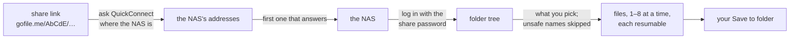

# Synology Share Downloader

**Download a Synology share link file by file, with resume, instead of as one giant ZIP.**

<!-- bricoleur:intro -->
> Part of **[bricoleur.ai](https://bricoleur.ai)**: small, honest tools cobbled together from the AI-era parts at hand.
<!-- /bricoleur:intro -->

[](https://github.com/shawnrancatore/synology-share-downloader/releases)
[](https://github.com/shawnrancatore/synology-share-downloader/actions/workflows/ci.yml)
[](LICENSE)
[](https://github.com/shawnrancatore/synology-share-downloader/releases)



## What it does

Synology's own download button on a shared folder bundles everything into one
ZIP, so a network blip on a big folder means starting over. This app fetches the
files one by one instead.

- Opens a Synology folder-share link (the `gofile.me` kind, which goes through
  QuickConnect, Synology's service for finding a NAS by name) with the share's
  password. You need no Synology account.
- Shows the share as a folder tree and downloads what you pick, or the whole
  share, 1 to 8 files at a time (4 by default), keeping the folder structure.
- Resumes: an interrupted file continues from its `.part` file, and a re-run
  skips files that are already complete. Files and folders keep the modified
  dates the share lists for them, and on Windows the creation dates too.

## Quick start

Most people want a ready-made build: see [Download a release](#download-a-release).
To run it from source, with Python 3.9 or later:

```sh
git clone https://github.com/shawnrancatore/synology-share-downloader
cd synology-share-downloader
python3 -m venv .venv
. .venv/bin/activate
pip install -r requirements.txt
python app.py
```

On Windows, make the venv with `py -m venv .venv` and activate it with
`.venv\Scripts\activate`. On Debian or Ubuntu, Tkinter (the GUI toolkit) comes
from the `python3-tk` package.

Paste the share link and its password, click **Connect**, pick folders or files,
choose a folder under **Save to:**, and click **Download selected**.
[docs/USAGE.md](docs/USAGE.md) walks through each screen.

**How to tell it worked:** a window titled **Synology Share Downloader** opens
with the **Share link:** and **Password:** boxes and **Connect** at the top, and
`Enter a share link and password, then click Connect.` above the log.

## How it works

The link carries two ids: the NAS's QuickConnect id and the share's own id. The
app asks QuickConnect where that NAS is, tries its addresses in a fixed order,
and uses the first that answers. It logs in to the share with the password,
lists folders through Synology's `FolderSharing` web API, and downloads each
file over HTTPS. An interrupted file resumes with an HTTP Range request, which
asks for the file from a given byte onwards. Before anything is written, each
name from the share is checked, so that every file lands inside your
**Save to:** folder. The
[full guide](https://bricoleur.ai/projects/synology-share-downloader) walks
through each step.

The protocol code is in
[`synology_share_downloader/client.py`](synology_share_downloader/client.py),
apart from the GUI, so you can use `SynoShareClient` from your own scripts. Its
docstrings are its only documentation.

## What it deliberately does not do

- **No content check.** A file counts as complete when its size on disk matches
  the size the share lists. There is no checksum, so a local file of the right
  size but different content is skipped, not downloaded again.
- **No certificate check on direct addresses.** The QuickConnect lookup and the
  NAS's QuickConnect name use verified HTTPS. The fallback to the NAS's public
  IP, DDNS name and local addresses does not check the certificate. The app
  logs `certificate not verified for <host>` and asks before it sends the
  password that way. See [Connections and certificates](#connections-and-certificates).
- **QuickConnect share links only.** It opens folder-share links on `gofile.me`,
  `quickconnect.to` and `quickconnect.cn`. It does not sign in to a Synology
  account, and it does not use QuickConnect's relay service, so the app must be
  able to reach the NAS directly.
- **No names that are unsafe on any system.** To keep every file inside
  **Save to:** on Windows, macOS and Linux alike, it skips a name with a `..`
  part, a backslash, a `:`, a control character or one of `< > " | ? *`, a name
  that ends with a dot or a space, and a Windows device name such as `CON`,
  `NUL` or `aux.c`. It skips them on every system, so a Linux share with a file
  named `aux.c` or `a:b` downloads without it. Each skip is logged.
- **No writing through links.** It never writes through a symbolic link: if
  the file to write, or its `.part` file, is one, it skips that file. It also
  skips a `.part` file that has another hard link. A symbolic link to a folder
  is followed only when it leads inside **Save to:**. A local user who can
  rewrite folders inside **Save to:** during a download is out of scope.
- **No sync and no upload.** It copies from the share to your computer. It
  changes nothing on the share and removes no local file that has gone from the
  share. A local file with the same name and a different size is downloaded
  again and replaced.
- **No code signing.** The release builds are unsigned, so Windows and macOS
  warn the first time you open one.

## Download a release

Get the archive for your OS from the
[Releases](https://github.com/shawnrancatore/synology-share-downloader/releases)
page:

| OS | Download | Run |
|----|----------|-----|
| Windows | `…-win64.zip` | Unzip, double-click `SynologyShareDownloader.exe` |
| macOS (Apple Silicon) | `…-macos-arm64.zip` | Unzip, drag `SynologyShareDownloader.app` to Applications, open it |
| Linux (x86-64) | `…-linux-x86_64.tar.gz` | `tar xzf …tar.gz`, then `./SynologyShareDownloader` |

There is no installer and no Python needed. There is no build for Intel Macs:
run it from source there, as in [Quick start](#quick-start).

The apps are not code-signed, so the first run prompts:

- **Windows:** SmartScreen → **More info** → **Run anyway**.
- **macOS:** right-click the app → **Open** → **Open**, or *System Settings →
  Privacy & Security → Open Anyway*.
- **Linux:** if it won't start, make it executable with
  `chmod +x SynologyShareDownloader`.

## Verify your download

Releases are built in GitHub Actions from this repo's source, by
[`.github/workflows/release.yml`](.github/workflows/release.yml). From v1.2.1
on, each release carries a `SHA256SUMS.txt` with the SHA-256 of each archive.
Compare your download with it (use the version you downloaded):

```powershell
Get-FileHash .\SynologyShareDownloader-v1.2.1-win64.zip -Algorithm SHA256
```

```sh
shasum -a 256 SynologyShareDownloader-v1.2.1-macos-arm64.zip     # macOS
sha256sum SynologyShareDownloader-v1.2.1-linux-x86_64.tar.gz     # Linux
```

The release workflow also records a build-provenance attestation for the
archives: signed proof that they were built by that workflow from this repo. A
failure in that step does not stop a release, so a release can lack one. v1.2.1
has one. Check it with the GitHub CLI:

```sh
gh attestation verify SynologyShareDownloader-v1.2.1-linux-x86_64.tar.gz \
  --repo shawnrancatore/synology-share-downloader
```

**How to tell it worked:** the hash matches the line for your file in
`SHA256SUMS.txt`, and the `gh` command prints `✓ Verification succeeded!` with
`Build workflow:. .github/workflows/release.yml@refs/tags/v1.2.1`.

On Windows, removing the first-run prompt needs Authenticode code signing, such
as an OV or EV certificate or [Azure Trusted Signing][ats]. A signing step
could be added to the release workflow; contributions are welcome.

[ats]: https://learn.microsoft.com/azure/trusted-signing/

## Connections and certificates

The app looks the NAS up with QuickConnect's coordinator
(`global.quickconnect.to`, then `global.quickconnect.cn`) over verified HTTPS.
It then tries the addresses the coordinator reports, in this order, and uses
the first that answers:

| Order | Address | Certificate |
|---|---|---|
| 1 | the NAS's QuickConnect name, on its external port | verified |
| 2 | its public IP address, on its external port | not verified |
| 3 | its DDNS name, on its HTTPS port, then on its external port | not verified |
| 4 | its QuickConnect LAN names, on its HTTPS port | verified |
| 5 | its local IP addresses, on its HTTPS port | not verified |

The HTTPS port is 5001 unless the coordinator reports another. The unverified
addresses typically carry the NAS's own self-signed certificate, which the app
cannot check. Connecting to one logs:

```text
Warning: certificate not verified for <host>. The app cannot confirm this is your NAS.
```

Before it sends the share password over that connection, the app asks
**Send the share password over this connection?** **No** stops, and the
password is not sent. **Yes** carries on, and the app doesn't ask again for that
host until you restart it. An unverified connection doesn't prove who is at the
other end: someone in between could read the password and the files.

In your own scripts, pass `SynoShareClient` a `confirm_unverified(host)`
callback to make the same choice. Without one, the client logs the warning and
logs in.

## Build from source

PyInstaller builds for the OS it runs on, so build on each platform you want to
ship. With Python 3.9 or later:

```sh
pip install -r requirements.txt pyinstaller
python build.py --zip
```

The app and its archive land in `dist/`: `…-win64.zip`, `…-macos-<arch>.zip`
containing the `.app`, or `…-linux-<arch>.tar.gz`. A release build runs in
GitHub Actions when a `v*` tag is pushed.

## Contributing

Contributions are welcome. This project is meant to be one place the community
works on together, rather than a scatter of forks. Please:

1. Read [CONTRIBUTING.md](CONTRIBUTING.md) and the
   [Code of Conduct](CODE_OF_CONDUCT.md).
2. Open an [issue](https://github.com/shawnrancatore/synology-share-downloader/issues)
   to discuss a bug or feature before large changes. Never paste a share link
   or its password into an issue.
3. Fork, branch, and open a pull request. Keep PRs focused, run the tests
   (`pytest`) and the linter (`ruff check .`), and describe the change.

Good first contributions: localization, a drag-and-drop target for share links,
an in-app update check, or code-signing the Windows build.

## License

Licensed under the **Apache License, Version 2.0**: see [LICENSE](LICENSE) and
[NOTICE](NOTICE). You can use, modify and redistribute it, including
commercially, as long as you keep the notices.

© 2026 **Dynamo Foundry LLC**, a Software Company.

*Not affiliated with Synology Inc. "Synology" and "QuickConnect" are trademarks
of Synology Inc., referenced here only to describe interoperability.*

## The full guide

From share link to finished download, with the reasoning behind each limit:
**[bricoleur.ai/projects/synology-share-downloader](https://bricoleur.ai/projects/synology-share-downloader)**.

<!-- bricoleur:footer -->
---
Part of **[bricoleur.ai](https://bricoleur.ai)** · [Full guide](https://bricoleur.ai/projects/synology-share-downloader) · Apache-2.0 © 2026 Dynamo Foundry LLC
<!-- /bricoleur:footer -->
